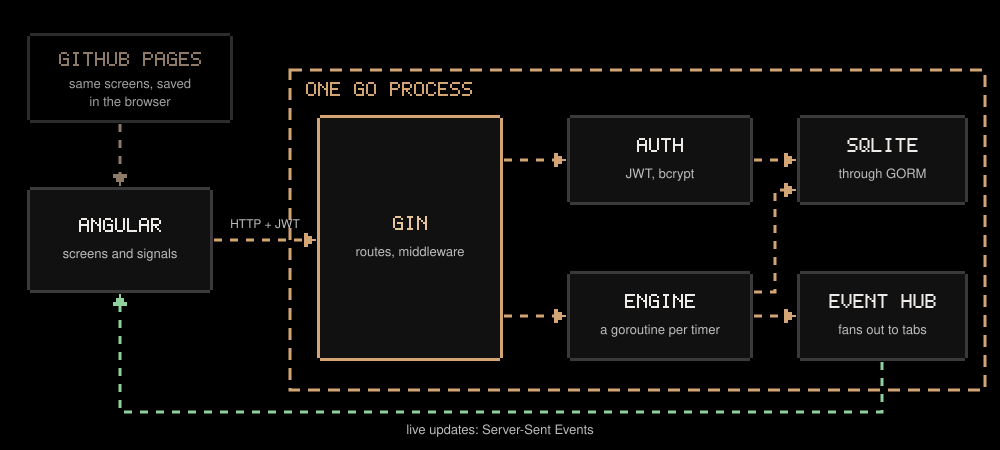

<p align="center"></p>

<p align="center"><b><a href="https://hrushibhatt.github.io/BrewFocus/">Open the app</a></b></p>




## Everything runs in the browser



| Choice | Why |
|---|---|
| No server | GitHub Pages only serves static files, and a server without sign-in would show every visitor the same data |
| No accounts | Data on your own device needs no password to protect it |
| One JSON document in `localStorage` | Reads are instant, so screens have no loading states |
| `BroadcastChannel` between tabs | Pausing in one tab pauses them all |
| Web Lock on the deadline | Every tab sets an alarm, and exactly one logs the block |

**The trade-off:** your data stays on one device and browser, with no sync between them.

## A deadline, not a counter


Browsers throttle timers in background tabs, and a closed tab runs nothing, so a counter loses time. The app saves when a block ends and works out the rest. A block that ran out while the tab was closed is credited on your return.

## One flow for every block


An intention gives a block a purpose, and a reflection makes it count for more than minutes. One service, `Brew`, runs the whole cycle with Angular signals, so every screen shows the same state.

## Secure by having less


| Choice | Why |
|---|---|
| Policy in a `<meta>` tag | Pages can't send security headers |
| Fonts and code self-hosted | The policy can then refuse every other host |
| Theme script in its own file | The policy allows no inline scripts |
| Everything typed is shown as text | A task named `` can't run |
| The store checks and repairs what it reads | A damaged save can't break the page |

Browser tests check all of this against the built site.

## Pixel art, drawn in code


| Choice | Why |
|---|---|
| Mug and sprites drawn as SVG squares | Crisp at any size, with no image files to download |
| Ambience synthesized with Web Audio | Rain and lo-fi with no audio files |
| Color tokens for both themes | Light mode changes only tokens; the mug keeps its colors |
| Full-width grid with flexible columns | Uses the whole screen, then stacks on a phone |


## Small on purpose





Each page loads when it's opened, so the timer never downloads the heatmap.

## Every push deploys



A failure at any step leaves the live site as it was. The build takes its path from the repo's name, so a rename is fixed by the next push.

## The code

```
frontend/src/app/
  core/
    data/       the store: rules, saving, the timer's deadline, events
    state/      Brew (the focus flow), the timer display, helpers
    sound/      synthesized ambience and chimes
    theme/      light and dark
  features/     brew, tasks, progress, focus-flow, settings
  shared/       dialog frame, pipes, pixel art
frontend/e2e/   browser tests, against the site as Pages serves it
docs/assets/    generate.py draws these diagrams
```

```bash
make install
make web    # http://localhost:4200
make test   # unit tests
make e2e    # browser tests
```

[Changelog](CHANGELOG.md)
