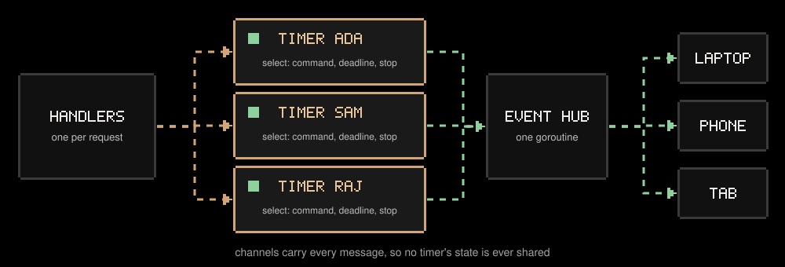
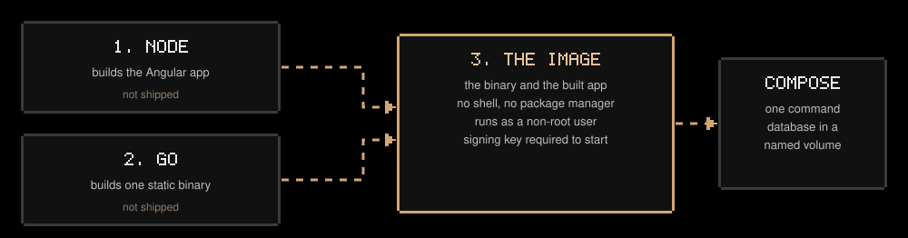

<p align="center"></p>

A pomodoro timer and productivity tracker with a Go backend. Timers run on the server, so a session keeps going when you close the tab and stays in sync across every device you're signed in on.

**[Try it in your browser](https://hrushibhatt.github.io/BrewFocus/)**, or run the full app with Docker:

```bash
cp .env.example .env                 # then set JWT_SECRET: openssl rand -hex 32
docker compose up --build            # http://localhost:5001
```


## Why Go

A timer app looks simple, but it has a hard requirement: many timers running at once, each of which can be paused from any device at the exact moment it expires. That's a concurrency problem, and concurrency is what Go was built for.


| Go feature or tool | What it does here | Why it fits |
|---|---|---|
| **Goroutines** | One for every running timer | Cheap enough to give each timer its own, so its logic reads top to bottom |
| **Channels and `select`** | Carry pause, resume and finish commands to each timer | A pause and an expiring deadline are handled one at a time, so they can't race |
| **`context` and `errgroup`** | Stop everything together on shutdown | A restart never cuts a request off or loses a timer |
| **`net/http` with Gin** | Routes, middleware and JSON validation | Each request already runs on its own goroutine, and Gin adds only what's missing |
| **GORM with pure-Go SQLite** | Tables and queries | No database server to run, and bound parameters rule out SQL injection |
| **`golang-jwt` and `x/crypto/bcrypt`** | Sessions and password hashing | Well-reviewed libraries, so the sensitive parts aren't hand-written |
| **Static binaries** | One file with no dependencies | The Docker image needs almost nothing else inside it |
| **`go test -race`** | Runs on every push | Catches data races as a test failure instead of a production mystery |
| **`govulncheck`, `gosec`, `go vet`** | Run in CI | Vulnerability and code scanning come from the Go ecosystem itself |

## A goroutine per timer



Each timer owns its state, and only its own goroutine touches it, so that state needs no locks. Its `select` waits on three things: a command, its deadline, or shutdown. See [`internal/engine`](backend/internal/engine/engine.go).

Updates reach the browser over Server-Sent Events rather than WebSockets. Clients only listen, since commands go over normal HTTP, and browsers reconnect to SSE on their own.



Measured with `BenchmarkRunningTimers`, each timer's in-memory database row included.

## JWT sign-in



| Choice | Why |
|---|---|
| JWT in an HttpOnly cookie, not `localStorage` | An injected script can't read it, so it can't steal it |
| A session row behind each JWT | A JWT alone can't be taken back before it expires. Deleting the row makes logging out instant |
| HS256 with one secret | Only one service verifies tokens, so public-key signing would add keys to manage for nothing |
| The algorithm is pinned when verifying | A forged token can't choose its own, such as `none` |
| The server won't start without a strong key in production | A guessable key would let anyone forge a session |


## Docker



The multi-stage build uses Node and the Go compiler but ships neither. With no shell or package manager in the image, there's little for an attacker to use. Compose keeps the database in a named volume, and runs the container read-only with no extra privileges.

## Two ways to run, one set of screens

GitHub Pages only serves static files, so it can't run Go. The [Pages build](https://hrushibhatt.github.io/BrewFocus/) swaps the server for an in-browser store that answers the same `/api` calls and saves to `localStorage`.

| | Go server | GitHub Pages |
|---|---|---|
| **Sign-in** | JWT | None needed |
| **Data** | SQLite on the server | This browser only |
| **Timers** | Run on the server | Saved deadline, in the browser |
| **Sync** | Every device | Tabs in one browser |
| **Runs on** | Docker, or any server | Static hosting |

The screens can't tell which one they're talking to, so there's only one UI to maintain.

## A deadline, not a counter


Timers save when they end rather than counting down. A background tab, a closed laptop or a server restart can't lose time, and a block that ran out during a restart is credited when the server comes back.

## One flow for every block


An intention gives a block a purpose, and a reflection makes it count for more than minutes.


## Security


Tests cover each of these, including forged JWTs and one user reaching for another's data.

## Kept simple on purpose


This app once had Google Calendar and an AI planner. They were removed because a timer doesn't need them, and the backend is now only what a timer and tracker require.


## Every push is tested


A failed check leaves the live site as it was. The Docker image is built and scanned alongside, on its own, so a newly published vulnerability in a base image can't take the site offline. The full app isn't hosted anywhere public yet: that image can run on any host that runs containers.

## The code

```
backend/
  cmd/server/          startup, configuration, graceful shutdown
  internal/
    api/               HTTP routes, one file per resource
      middleware/      security headers, size limits, rate limits
    auth/              JWT sessions, bcrypt, CSRF
    engine/            the timers: one goroutine each
    events/            live updates to every open tab
    store/             database models and SQLite setup
frontend/src/app/
  core/
    api/               API client, data shapes, live event stream
    auth/              the signed-in user and route guards
    browser/           the in-browser store, for the Pages build only
    state/             Brew (the focus flow), the timer display
    sound/, theme/     synthesized ambience, light and dark
  features/            brew, tasks, progress, focus-flow, settings, login
  shared/              dialog frame, pipes, pixel art
frontend/e2e/          browser tests against the Go server
frontend/e2e-pages/    browser tests against the Pages build
```

Each Go package starts with a comment explaining its design decisions.

| Command | What it does |
|---|---|
| `make install` | Download dependencies |
| `make api` and `make web` | Run the API on :5001 and the app on :4200 |
| `make serve` | Build everything and serve it from one Go process on :5001 |
| `make docker` | Run the app with Docker Compose |
| `make test` | Go tests under the race detector, then frontend unit tests |
| `make e2e` | Browser tests against the real Go server |
| `make audit` | Vulnerability, code and secret scans |
| `make pages` | Run the browser-only build |

[Changelog](CHANGELOG.md)
