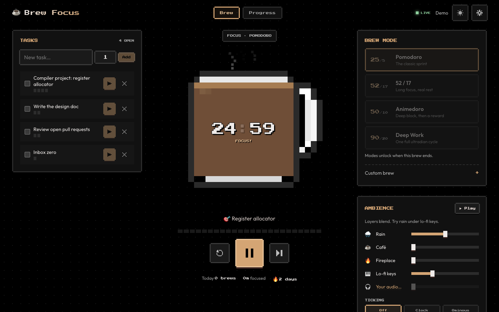
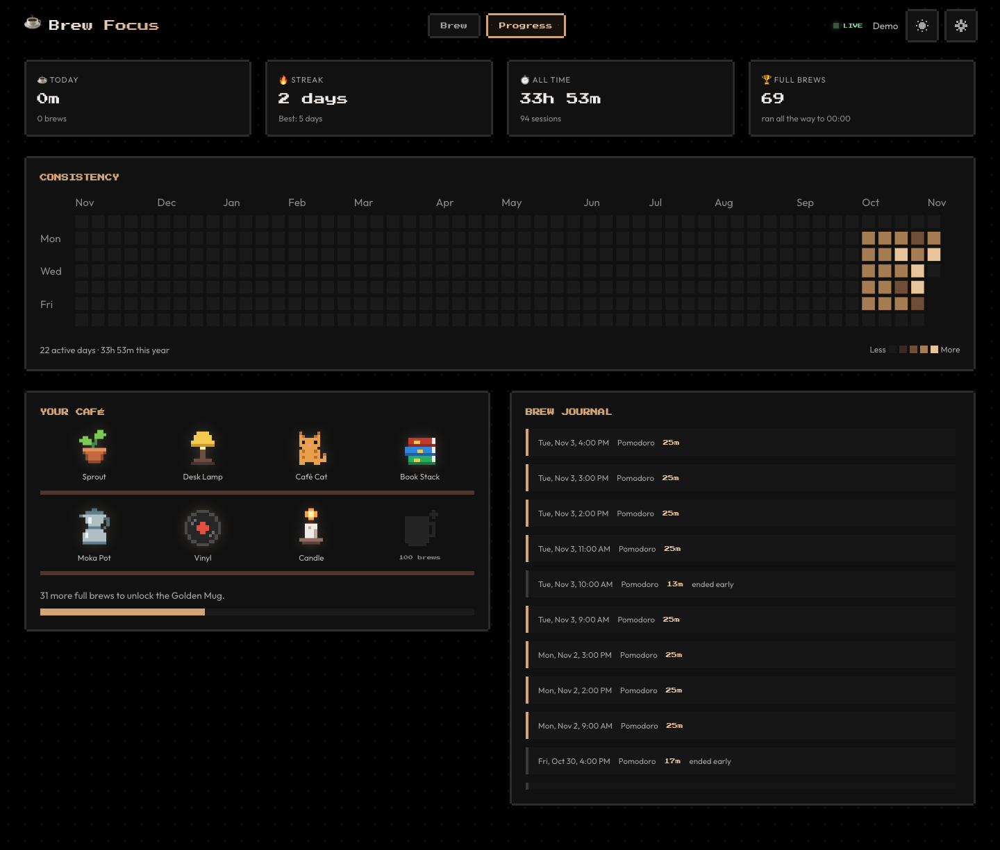
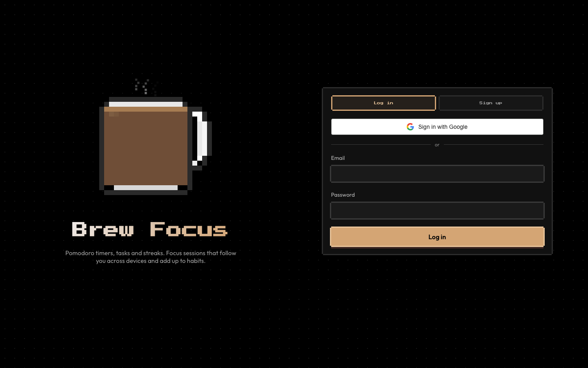
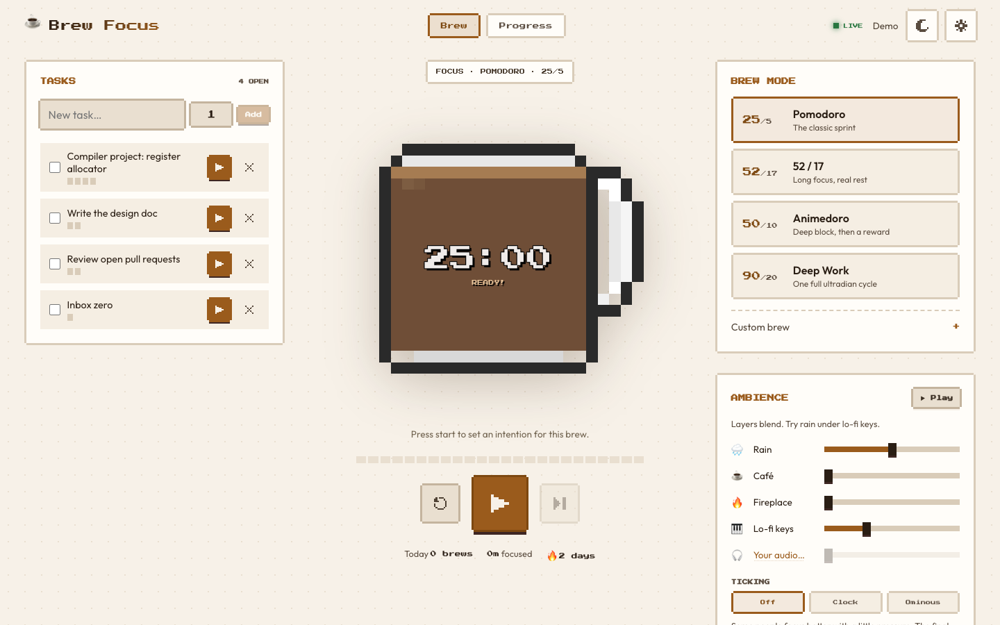

# ☕ Brew Focus

A pomodoro timer and productivity tracker, with a pixel-art mug that drains as you work. Timers run on the server, so a session keeps going when you close the tab and stays in sync across every device you're signed in on.

**[Try the live demo](https://hrushibhatt.github.io/AI-Calendar-Scheduling-Assistant/)**: it runs entirely in your browser with sample data, so there's no sign-in.





<table>
  <tr>
    <td width="50%"></td>
    <td width="50%"></td>
  </tr>
</table>

## Features

| | |
|---|---|
| **Timers** | Pomodoro 25/5, 52/17, Animedoro 50/10, Deep Work 90/20, or your own |
| **Focus flow** | Set an intention, breathe, focus, write a one-line reflection, take a break |
| **Tasks** | Estimate tasks in focus blocks and track the time spent on each |
| **Progress** | Today's totals, streaks, a year heatmap, a journal, and a pixel café that fills as you finish brews |
| **Live sync** | Start on your laptop and pause on your phone. Every open tab follows along |
| **Ambience** | Mix rain, café, fireplace and lo-fi layers, or play your own audio file |
| **Strict mode** | Tab switches during focus are logged as distractions |
| **Light and dark** | Dark by default, one click to switch, and it remembers your choice |
| **Accounts** | Email and password, or sign in with Google |

## Quick start

You need Go 1.27+ and Node 24.15+.

```bash
make install   # download dependencies
make api       # terminal 1: the Go API on :5001
make web       # terminal 2: the app on http://localhost:4200
```

Use `make demo` in place of `make api` for a seeded account: `demo@brewfocus.dev` / `brewfocus`.

Settings go in `.env`: copy [`.env.example`](.env.example). Nothing is needed for local use. In production, set `JWT_SECRET` and `SECURE_COOKIES=true`.

## Commands

| Command | What it does |
|---|---|
| `make api` / `make web` | Run the API and the app for development |
| `make demo` | Run the API with a seeded demo account |
| `make serve` | Build everything and serve it from one Go process on :5001 |
| `make test` | Go tests under the race detector, then Angular unit tests |
| `make e2e` | Browser tests against the real Go server |
| `make audit` | Vulnerability, code and secret scans |
| `make docker` | Build and run the production image |
| `make pages` | Run the browser-only demo on :4200 |
| `make pages-build` | Build the site CI publishes, then test it with `cd frontend && npm run e2e:pages` |

## How the code is organized

```
backend/
  cmd/server/            startup and configuration
  internal/
    api/                 HTTP routes, one file per resource
      middleware/        security headers, size limits, rate limits
    auth/                passwords, sessions, Google sign-in, CSRF
    engine/              server-run timers: one goroutine per running timer
    events/              live updates to every open tab
    store/               database models and SQLite setup
    demo/                the sample account

frontend/src/app/
  core/
    api/                 API client, data shapes, live event stream
    auth/                the signed-in user and route guards
    state/               the Brew service (app state), timer, helpers
    sound/               synthesized ambience and chimes
    theme/               light and dark
    demo/                the browser-only backend for the live demo
  features/
    brew/                the timer page: mug, modes, ambience
    tasks/               the task list
    progress/            stats, heatmap, café, journal
    focus-flow/          intention, breathing and reflection dialogs
    settings/            settings and account security
    login/               the sign-in page
  shared/                dialog frame, pipes, Google logo
    pixel-art/           the mug and sprites

frontend/e2e/            browser tests against the Go server
frontend/e2e-pages/      browser tests against the static demo
```

**How a timer works.** The server owns the clock. Each running timer is a goroutine that holds its own state and takes commands (pause, resume, finish) over a channel, so it needs no locks. It writes to SQLite as it goes, so a restart resumes it, and it publishes each change to every open tab over Server-Sent Events. The browser only displays what the server says.

**The stack.** Go, Gin, GORM and SQLite on the server. Angular with signals on the client. One process serves both.

## Security

- Passwords are hashed with bcrypt and checked for strength. Google accounts are matched on Google's permanent ID, never on email.
- Sessions are signed cookies backed by a database row, so signing out takes effect immediately.
- Every query is scoped to the signed-in user, and state-changing requests need a CSRF token.
- Sign-ins are rate limited per address and per account.
- A strict Content-Security-Policy allows no outside scripts or inline scripts, and fonts are self-hosted.
- CI runs vulnerability, code and secret scans, and pins every dependency.

## Tests

Measured on the last run: **64 backend tests** with 7 subtests, always under the race detector, **33 frontend unit tests**, and **14 browser tests**: 4 against the Go server and 10 against the static demo. `make audit` found no vulnerabilities in the code paths the app uses and no leaked secrets.

The Docker image is built and scanned in CI. It hasn't been built on a local machine.

## Deployment

The live demo publishes to GitHub Pages on every push to `main`, once its browser tests pass. Pages only serves static files, so the demo runs an in-browser backend instead of the Go server, and it never asks for a password.

The full app with accounts isn't hosted anywhere public yet. The `Dockerfile` builds a single image for any host that runs containers. Mount a volume at `/data` for the database.

See [CHANGELOG.md](CHANGELOG.md) for what changed.
