<div align="center">


<br/>

[](https://github.com/HrushiBhatt/AI-Calendar-Scheduling-Assistant/actions/workflows/ci.yml)
[](https://github.com/HrushiBhatt/AI-Calendar-Scheduling-Assistant/actions/workflows/codeql.yml)


**A retro pixel-art focus timer that plans your deep work around your real calendar.**<br/>
Ask for *"three blocks on the compiler project tomorrow"*. A deterministic scheduler finds the real gaps between your meetings,<br/>
tells you why it chose each one, and starts each block by itself. The timers run on the server, so they survive a closed tab.

[**▶ Try the live demo**](https://hrushibhatt.github.io/AI-Calendar-Scheduling-Assistant/) · [See it run](#see-it-run) · [How it works](#how-it-works) · [Security](#security) · [Run it](#run-it) · [Architecture](ARCHITECTURE.md) · [Changelog](CHANGELOG.md) · [For AI agents](AGENTS.md)

</div>

---

## See it run

<div align="center">
  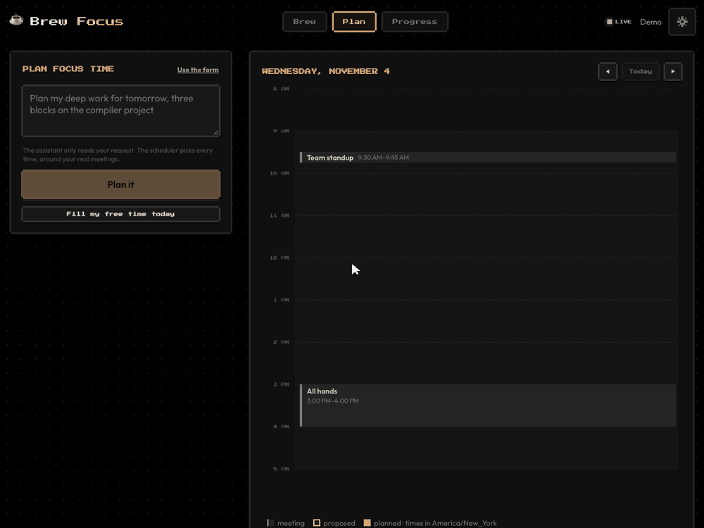
  <br/>
  <sub>Recorded from the running app with the demo account. The calendar is the demo's in-memory one and the assistant is the test stand-in for the model; the scheduler, timer and interface are the real code.</sub>
</div>

<div align="center">

### [▶ Try the live demo](https://hrushibhatt.github.io/AI-Calendar-Scheduling-Assistant/)

No sign-up. It opens with sample tasks, meetings and a month of history.

</div>

The demo runs entirely in your browser, and **its scheduler is the same Go code as the full app**, compiled to WebAssembly. GitHub Pages only serves static files, so the parts that need a server are stood in for, and the page says so:

| | Live demo (GitHub Pages) | Full app (Go server) |
|---|---|---|
| **Scheduler** | The real one, as WebAssembly | The real one |
| **Timer** | In your browser. It survives a reload and syncs across tabs | On the server. It survives a closed tab and syncs across devices |
| **Calendar** | A sample calendar | Your Google Calendar |
| **Plain-language requests** | A simple phrase matcher | The Claude API |
| **Accounts** | None: nothing you type leaves your device | Google sign-in or a password |

## What it does

| | Feature | What you get |
|:-:|---|---|
| ☕ | **Timers that run on the server** | Close the tab, switch devices or restart the server. A running block keeps its place, and every open tab stays in sync |
| 🗓️ | **Day, week and month** | See your meetings and focus blocks at any scale, and drag blocks between hours and days |
| 🤖 | **Calendar-aware planning** | Connect Google Calendar and blocks land only in real free time, around meetings, buffers and lunch |
| 💬 | **One bar to ask** | Type what you want from almost any screen, and a plan screen opens. Options reach the same scheduler and need no AI at all |
| 🧠 | **Explained decisions** | Every block says why it's there: *"you finish 88% of blocks you start at this hour"* |
| ✅ | **You stay in charge** | Accept all, some or none, and drag blocks around. Nothing on your schedule moves without you |
| ⏰ | **Blocks that start themselves** | A 60-second countdown offers Start now, Delay 10 min or Skip. If you do nothing, it starts |
| 🔄 | **Reacts to your calendar** | A meeting lands on an accepted block? The block is flagged and a replacement is proposed |
| 📈 | **Progress you can see** | Streaks, a year heatmap, a reflection journal, planning metrics and a pixel café that grows as you finish brews |
| 🎧 | **A place to focus** | Mix rain, café, fireplace and lo-fi ambience, breathe before a block, and log distractions in strict mode |
| 🏔️ | **Liquid glass** | Content floats on translucent glass over a 4K photograph, with smooth transitions between screens |
| 🌗 | **Light and dark** | Follows your system, or pick one. The choice is remembered and never flashes the wrong theme on load |
| 🔐 | **Accounts built to be hard to break** | Sign in with Google or a bcrypt-hashed password. Sessions end for real when you sign out |

<table>
  <tr>
    <td width="33%">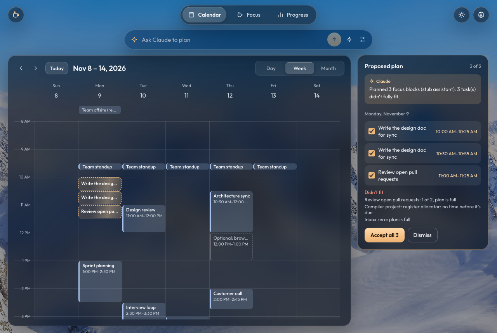</td>
    <td width="33%">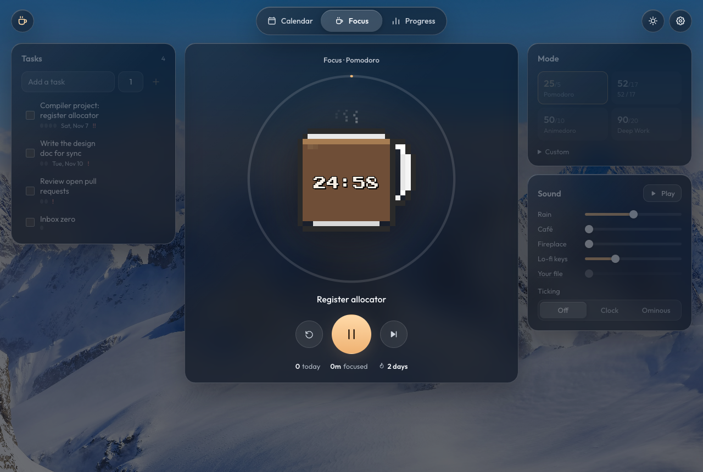</td>
    <td width="33%"></td>
  </tr>
  <tr align="center">
    <td><sub><b>Plan.</b> Review it where the time is</sub></td>
    <td><sub><b>Focus.</b> The timer lives on the server</sub></td>
    <td><sub><b>Progress.</b> Habits and planning metrics</sub></td>
  </tr>
</table>

<div align="center">
  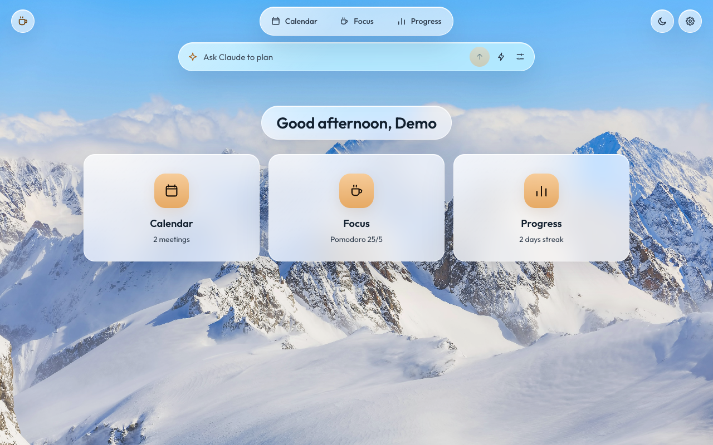
  <br/>
  <sub><b>Home, in light mode.</b> One door to each part of the app</sub>
</div>

## How it works

### 1. A sentence becomes a plan, but the model never picks a time


The language model has exactly two jobs: turn your words into a structured request, and describe the finished plan. **Every placement comes from a pure function** with no network, no clock and no model inside it. That choice is what makes the feature testable with ordinary tests, keeps it working when the provider is down, and means "why 2 pm?" always has a real answer.

<details>
<summary><b>Sequence diagram: from request to running timer</b></summary>

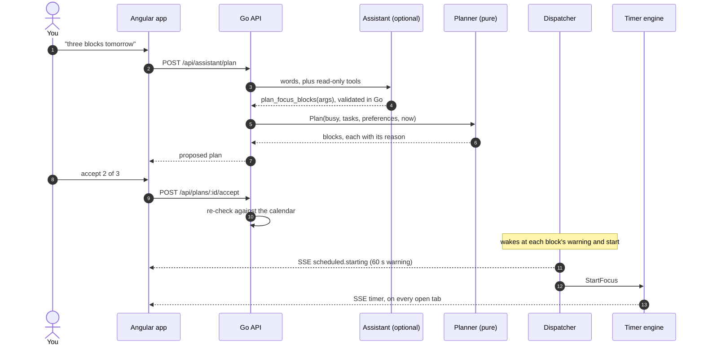

</details>

### 2. The scheduler picks every time


The scheduler lists every start time that could work, throws out anything that breaks a hard rule, scores what's left, and takes the best slot for each task in turn. A workday has about 32 starting points on a 15-minute grid, so checking them all is fast and easy to explain. A solver would be neither. It's strict about time too: days are built in your own time zone, so a daylight-saving day really is 23 or 25 hours long.


A new user has no history, so each hour starts at a neutral prior and blends toward your own completion rate as sessions accumulate. A task that can't fit is reported with a reason and never dropped silently.

### 3. The timer lives on the server


Each running timer is one goroutine that owns its state and takes commands over a channel, so there are no locks and nothing to race. Sessions are written to SQLite when they start and on every change, and a restart restores them. One deliberate asymmetry: a block that came due while the server was down is **skipped**, not started late, because a 50-minute block landing three hours late would interrupt whatever you're doing now.

<details>
<summary><b>State diagrams: a timer and a planned block</b></summary>

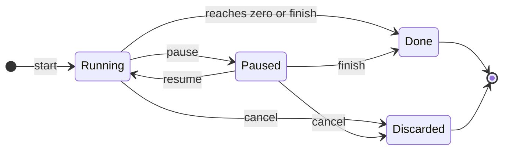

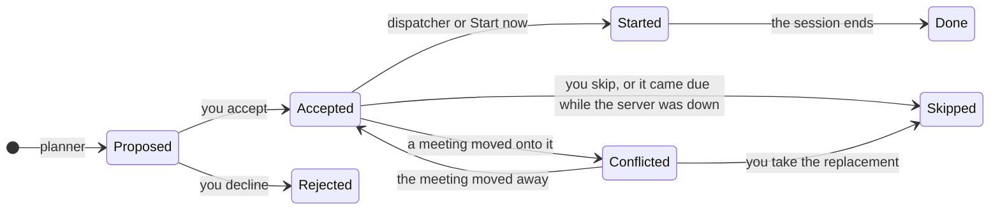

</details>

## Security


| What an attacker tries | What stops it |
|---|---|
| Stealing or cracking passwords | **bcrypt at cost 12**, 281 ms per hash on an Apple M2. New passwords need 12 characters and a [zxcvbn](https://github.com/trustelem/zxcvbn) strength check. Older hashes upgrade at the next sign-in |
| Guessing a login | Rate limits per address and per account, and an unknown email takes as long to reject as a wrong password |
| Reusing a stolen session | **Sessions live on the server.** Signing out, changing a password or "sign out everywhere" ends them at once, event streams included |
| Reading the session cookie from a script | `HttpOnly`, so page scripts can't see it. `SameSite=Lax`, plus `Secure` and a `__Host-` prefix over HTTPS |
| Running injected code in the page | A strict **Content-Security-Policy** with no inline scripts and no third-party hosts. Fonts are self-hosted, so even font servers don't learn who visits |
| Forging a request from another site | Two independent checks: a double-submit CSRF token and Go's cross-origin protection |
| Abusing the Google sign-in flow | **OAuth 2.0 authorization code with PKCE**, plus a nonce and a fully verified OpenID Connect ID token |
| Registering your email first, then waiting for you | Accounts link on Google's permanent ID. A matching email never joins an existing account |
| Reading someone else's data | Every query is scoped to the signed-in user, and tests check it across accounts |
| Stealing calendar access from a database leak | Calendar tokens are sealed with **AES-256-GCM** under a key kept outside the database. The database file is readable by its owner alone |
| Finding secrets in the logs | Query strings and SQL values are never logged, because OAuth codes and session IDs would otherwise end up there |
| Slipping in through a dependency | gitleaks, CodeQL, govulncheck, gosec, npm audit and Trivy in CI. Actions are pinned to commits and base images to digests, and Dependabot proposes updates |

<details>
<summary><b>Sequence diagram: signing in with Google</b></summary>

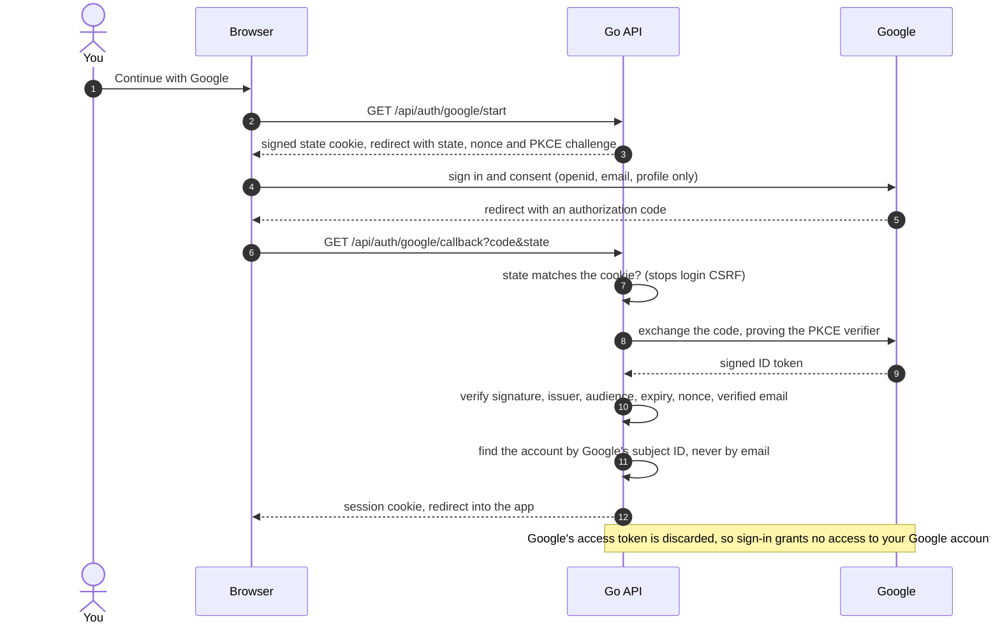

</details>

**Known limits.** There's no email verification or password reset yet, because the app doesn't send email. Tasks and reflections aren't encrypted individually, so production should sit on an encrypted disk. Details and the plan to close these are in [ARCHITECTURE.md](ARCHITECTURE.md#known-gaps-and-roadmap).

## Built to be checked

| Measure | Result |
|---|---|
| Backend tests | **141 tests and 441 subtests**, always under the race detector in CI |
| Frontend tests | **106 unit tests** and **11 full browser tests**: 2 against the Go server and 9 against the static demo, served the way GitHub Pages serves it |
| Scheduler | **17 golden fixtures**, including a daylight-saving day and a red-eye across midnight, plus a property test over **400 random calendars** in five time zones |
| Scheduler speed | **About 82 µs** to plan a busy week (5 runs: 79 to 86 µs, Apple M2) |
| Password hashing | **281 ms** per bcrypt hash at cost 12 (Apple M2) |
| Assistant, real model | **29 of 30** prompts fully correct on `claude-haiku-5-5`, at about 5,900 tokens a request and 3.2 s typical latency ([one run](backend/internal/assistant/testdata/eval-results.md), 2026-11-04) |


<sub>The two low bars are startup wiring and demo seed data. The planner, engine and security code are what the suite is built around.</sub>

## Architecture

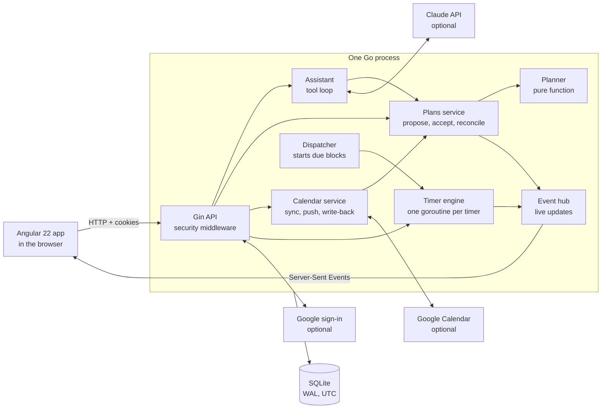

Why it's built this way, including what was tried and rejected, is in **[ARCHITECTURE.md](ARCHITECTURE.md)**.

| Layer | Technology |
|---|---|
| Backend | Go 1.27, Gin, GORM, SQLite (pure-Go driver, WAL) |
| Frontend | Angular 22 (standalone components, signals, zoneless), self-hosted fonts |
| Real time | Server-Sent Events |
| Integrations | Google Calendar API, Claude API (tool use), both optional |
| Authentication | OAuth 2.0 with PKCE and OpenID Connect ([go-oidc](https://github.com/coreos/go-oidc)), bcrypt, signed cookies with server-side sessions |
| Testing | Go race detector, golden files, property tests, Vitest, Playwright |
| Delivery | Docker on a distroless, non-root base, GitHub Actions, GitHub Pages for the live demo |

## Run it

Requires Go 1.27+ and Node 24.15+.

```bash
make install   # go mod download + npm install
make demo      # terminal 1: API on :5001 with a seeded demo account
make web       # terminal 2: Angular on :4200, then open http://localhost:4200
```

Sign in as **demo@brewfocus.dev** with password **brewfocus**. The demo has two weeks of meetings on an in-memory calendar, a few tasks and a month of history, so planning works with no keys at all.

To use Google sign-in, your real calendar and Claude, fill in `.env` as described below, then run `make api` instead of `make demo` and open `http://localhost:4200`. Use that exact address, because it's the one Google sends you back to. At startup the server logs which features are on, and the app shows any feature that's missing its keys as disabled, with what it needs.

| Command | What it does |
|---|---|
| `make test` | Go tests under the race detector, then the Angular unit tests |
| `make audit` | The security scans CI runs: vulnerable dependencies, risky code, leaked secrets |
| `make serve` | Everything in one process on :5001. Needs `JWT_SECRET`, because it runs in release mode |
| `make pages` | The browser-only demo on :4200, with no Go server running |
| `cd frontend && npm run e2e` | The browser tests |

<details>
<summary><b>Configuration</b></summary>

Copy [`.env.example`](.env.example) to `.env`, which git ignores, and put real values only in `.env`. The app doesn't read `.env.example`, and git tracks it, so a key saved there could be published. Every feature is optional and degrades on its own.

| Variable | Needed for | Notes |
|---|---|---|
| `JWT_SECRET` | production | At least 32 bytes. Release mode refuses to start without it. `openssl rand -hex 32` |
| `SECURE_COOKIES` | HTTPS | `true` when served over HTTPS. The Docker image defaults to `true` |
| `TRUSTED_PROXIES` | a reverse proxy | Its addresses or CIDR ranges, so rate limits see real visitors |
| `GOOGLE_CLIENT_ID`, `GOOGLE_CLIENT_SECRET` | anything Google | One OAuth client serves both features below |
| `GOOGLE_LOGIN_REDIRECT_URL` | Google sign-in | e.g. `http://localhost:4200/api/auth/google/callback` |
| `GOOGLE_REDIRECT_URL` | Google Calendar | e.g. `http://localhost:4200/api/calendar/callback` |
| `CALENDAR_ENC_KEY` | a connected calendar | 32 bytes as hex. `openssl rand -hex 32` |
| `PUBLIC_URL` | push notifications | An `https://` URL Google can reach. Unset, calendars are polled every 5 minutes |
| `ANTHROPIC_API_KEY` | the assistant | Unset, the calendar offers the options form and says Claude isn't set up |
| `ASSISTANT_DAILY_TOKENS` | a higher or lower limit | Tokens per user per day, 50,000 by default. A request averaged about 5,900 in the eval, so that's about 9 a day |
| `DEMO` | trying it | `true` seeds the demo account. Its password is public, so don't enable it on a server holding real data |

</details>

<details>
<summary><b>Setting up Google sign-in and Calendar</b></summary>

1. In the [Google Cloud console](https://console.cloud.google.com/), create a project and enable the **Google Calendar API**.
2. Under **Google Auth Platform**, fill in **Branding**, set **Audience** to **External**, and click **Publish app**. Don't stay in Testing: Google ends calendar access every 7 days there, so you'd have to reconnect each week. A published app that isn't verified shows a warning you click through (**Advanced**, then go to the app), and is limited to 100 new users in total.
3. Under **Data Access**, add the scopes `openid`, `email`, `profile`, `.../auth/calendar.readonly` and `.../auth/calendar.app.created`.
4. Under **Clients**, create a client of type **Web application**, and add both redirect URIs from the table above.
5. Put the client ID, secret and redirect URIs in `.env`, add `CALENDAR_ENC_KEY`, and restart.

</details>

<details>
<summary><b>Deploying with Docker</b></summary>

The image holds the Angular build and a static Go binary on a distroless, non-root base. It needs a host that runs containers and keeps a disk for the database:

```bash
docker run -p 5001:5001 -v brewfocus-data:/data -e JWT_SECRET=… -e CALENDAR_ENC_KEY=… brew-focus
```

Timers and the event hub live in one process's memory, so run one instance. Scaling out would mean Postgres and a lease-based dispatcher.

The live demo is separate: every push to `main` rebuilds it and publishes it to GitHub Pages, once its browser tests pass. Pages only hosts static files, so it can't run this backend.

</details>

## Project status

| Area | State |
|---|---|
| Timer, tasks, progress, scheduler, planning flow | ✅ Built and tested |
| Accounts, sessions, security hardening | ✅ Built and tested |
| Google sign-in and Google Calendar | 🟡 Built and tested against a local stand-in. Google has accepted the sign-in and calendar requests from a real OAuth client, but a full sign-in and calendar sync with a real account hasn't been run yet |
| AI assistant | ✅ Built and run against the real model: **29 of 30** prompts fully correct on `claude-haiku-5-5` in [one eval run](backend/internal/assistant/testdata/eval-results.md) on 2026-11-04 |
| Public site | ✅ [Live demo](https://hrushibhatt.github.io/AI-Calendar-Scheduling-Assistant/) on GitHub Pages, deployed from `main` by GitHub Actions |
| Hosting the full app | ⬜ Not deployed yet. It needs a server that runs a container and keeps a disk |

See the [roadmap](ARCHITECTURE.md#known-gaps-and-roadmap) and [changelog](CHANGELOG.md).

## Repository structure

```
backend/
  cmd/server/          main, optional-feature config, startup checks
  internal/
    planner/           the pure scheduler, golden fixtures, property tests
    plans/             propose, accept, move, reconcile
    scheduler/         dispatcher: due blocks become running timers
    assistant/         Claude tool loop, narration guard, eval set
    calendar/          provider interface, Google, fake, sync, push, write-back
    engine/            server-run timers, one goroutine per timer
    events/            pub/sub hub behind the SSE stream
    auth/              bcrypt, sessions, OAuth sign-in, CSRF
    store/             GORM models, sealed tokens, SQLite
    api/               Gin handlers and security middleware
  cmd/plannerwasm/     the scheduler compiled to WebAssembly, for the live demo
frontend/src/app/      home, calendar, focus, tasks, progress, login, dialogs, core services
frontend/src/assets/   the background photograph
  core/local/          the live demo's in-browser backend and sample data
frontend/e2e/          browser tests against the Go server
frontend/e2e-pages/    browser tests against the static demo
docs/assets/           the images in this README
```

## License

MIT
